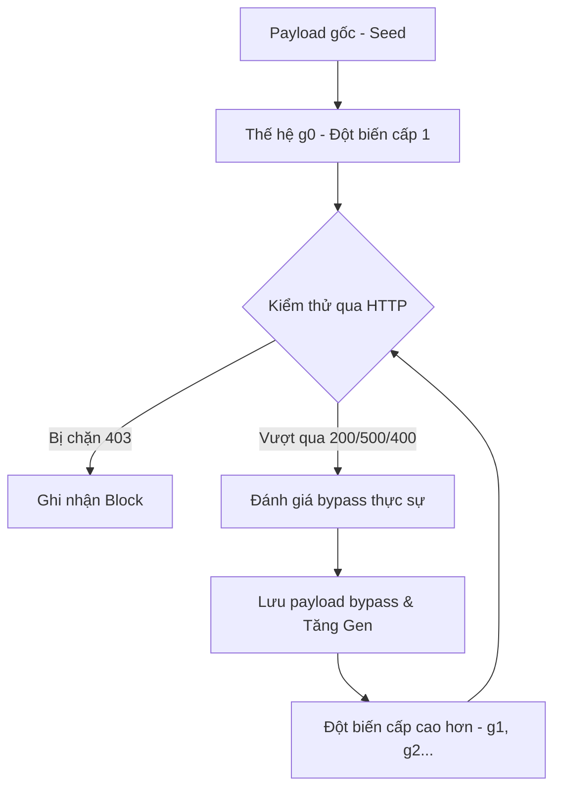

# WAF Mutation-Based Testing Framework

Tài liệu này mô tả chi tiết phương thức, mô hình hóa dữ liệu, kiến trúc kiểm thử đột biến (Mutation-Based Testing) và quy trình xác thực hiệu năng hệ thống WAF (AWS WAF) trong dự án nghiên cứu.

---

## 1. Phép Biến Đổi Đột Biến & Ép Gen (Chained Mutation & DFS Queue)

Hệ thống sử dụng phương pháp **Feedback-Driven Mutation Testing** (Kiểm thử đột biến hướng phản hồi) để đánh giá khả năng phòng chống tấn công SQL Injection (SQLi) của AWS WAF hoặc các WAF dựa trên Học máy (ML-based WAF). 



### Các Đặc Điểm Cốt Lõi:
1. **Ép Thế Hệ Đột Biến (DFS Queue Progression):**
   * Ưu tiên chèn các payload được spawn mới trực tiếp lên **đầu hàng đợi** (`queue.appendleft`). Khi phát hiện một payload bypass thành công, hệ thống sẽ tiến hóa nó ngay sang thế hệ tiếp theo (`g(n+1)`) thay vì phải đợi hết toàn bộ các payload thuộc thế hệ hiện tại (`gn`).
2. **Giới Hạn Tần Suất Biến Đổi (Per-Transform Capping):**
   * Để tránh tình trạng bão hòa không gian kiểm thử (ví dụ: sinh ra quá nhiều biến thể chỉ thay đổi kiểu chữ hoa/thường hoặc comment), hệ thống giới hạn tối đa **15 payload** đại diện cho mỗi loại bộ lọc biến biến đổi (`transform_key`) trên mỗi thế hệ. Điều này ép hàng đợi tiến lên các thế hệ phức tạp hơn nhanh chóng.
3. **Loại bỏ trùng lặp triệt để (Deduplication):**
   * Đảm bảo mọi request gửi đi đều chứa payload độc bản về mặt cấu trúc bằng bảng băm `seen_payloads`.

---

## 2. Tiêu Chí Xác Định Bypass Thực Sự (Exploitability Validation)

Nhóm nghiên cứu áp dụng bộ quy chuẩn nghiêm ngặt để xác định một request có thực sự bypass thành công hay không, tránh các trường hợp dương tính giả (false bypass do lỗi ứng dụng hoặc WAF chặn không hoàn toàn):

* **WAF Block (`blocked`):** Nhận diện qua mã trạng thái HTTP HTTP `403 Forbidden`, `406 Not Acceptable`, `429 Too Many Requests` hoặc sự xuất hiện của các chuỗi dấu hiệu WAF trong phản hồi (`request blocked`, `forbidden`, `access denied`, `"blocked":true`,...).
* **Bypass hiệu quả (`bypass`):** 
  1. **HTTP 200 OK chứa dữ liệu ứng dụng:** Hệ thống phải trả về kết quả dự án hợp lệ có định dạng JSON và chứa các thuộc tính dự án thực tế như `"projectName"`, `"name"`, hoặc `"applicationDomain"` (sử dụng hàm kiểm tra cấu trúc dữ liệu `contains_project_data`).
  2. **HTTP 500 lỗi logic Backend SQL:** Các mã lỗi HTTP 500 xuất phát từ lỗi cú pháp cơ sở dữ liệu backend (ví dụ: lỗi SQL compile từ PostgreSQL) nhưng không chứa các dấu hiệu lỗi mã hóa/chuyển mã UTF-8. Điều này chứng minh payload đã bypass qua WAF thành công, chạm tới backend và làm thay đổi logic câu lệnh SQL.
  3. **HTTP 400 / 422 lỗi logic ứng dụng:** Chứa các thông tin thông báo lỗi kiểu dữ liệu từ database backend (ví dụ: `invalid input syntax for type integer`).

---

## 3. Các Phép Biến Đổi Đột Biến (Mutations & Encodings)

Framework áp dụng 3 nhóm kỹ thuật đột biến chính:
1. **SQL Dialect Variants:** Các kỹ thuật chèn khoảng trắng (`/*x*/`, `%0a`, `%09`), thay thế câu lệnh logic (`OR true`, `OR 2=2`), lồng mã nguồn chuyên biệt cho PostgreSQL.
2. **AWS-Specific Variants:** Các kỹ thuật bypass signature của AWS WAF (ví dụ: UTF-8 Fullwidth, Multi-byte encoding, Percent double-encoding).
3. **Advanced ML-Blocked Mutations:**
   * **1st Layer:** Chuyển đổi mã hóa Hex toàn phần hoặc một phần, lồng chuỗi, đảo ngược, ghép nối chuỗi bằng toán tử concat (`||`).
   * **2nd Layer (Chained):** Lồng các lớp mã hóa chồng lên nhau (ví dụ: một chuỗi SQLi được đổi hoa/thường $\rightarrow$ chèn comment $\rightarrow$ URL encode kép).

---

## 4. Cấu Hình & Cách Vận Hành (How to Run)

### File Cấu Hinh `config.json`
Chỉnh sửa tham số cấu hình mục tiêu và mức độ kiểm thử tại `ml-waf-aws-test/config.json`:

* **base_url:** Domain/IP của máy chủ NestJS cần test.
* **max_requests:** Giới hạn tối đa số request gửi đi (Ví dụ: `5000`).

### Lệnh Vận Hành Kiểm Thử
* **Quét thử nghiệm (Dry-run):** In ra màn hình các payload chuẩn bị sinh ra để xác nhận định dạng mà không gửi request thật:
  ```bash
  python run_probe.py --dry-run
  ```
* **Chạy kiểm thử thực tế toàn diện:** Xóa toàn bộ dữ liệu cũ và tiến hành fuzzing qua nhiều thế hệ:
  ```bash
  python run_probe.py --full --fresh
  ```

---

## 5. Cấu Trúc Đầu Ra Báo Cáo (Output & Evaluation Logs)

Kết quả kiểm thử được lưu trữ tự động tại thư mục `ml-waf-aws-test/data/`:
* `aws_probe_summary.json`: Chứa thông tin thống kê tổng quát (tổng số request, tỷ lệ chặn, tỷ lệ bypass thành công, phân phối mã phản hồi HTTP).
* `aws_probe_report.txt`: Log chi tiết kết quả của từng request kiểm thử.
* `bypass_found.txt`: Danh sách chi tiết các payload độc hại đã bypass thành công.
* `learned_encodings.json`: Trọng số học máy ghi nhận hiệu quả lách luật của từng phương pháp mã hóa/đột biến phục vụ cho các lượt chạy tối ưu tiếp theo.
